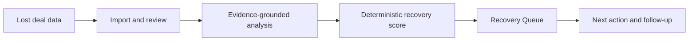

# LostDeal AI

**Turn lost sales opportunities into evidence-backed recovery decisions.**

LostDeal AI is a B2B SaaS application that helps sales teams, founders, and RevOps operators understand *why* deals were lost, prioritize the most promising opportunities to revisit, and plan the next action.

> **Project status — October 2026:** Technical V1 has completed the Prompt 17 QA milestone and is deployed as Sites Version 49. Public customer access, production email, custom domain, live Paddle approval, and broader commercial readiness are **not yet complete**. The [private deployment](https://lostdeal-ai.equal-dune-2306.chatgpt.site) may require owner authorization.

## What it does

| Capability | Outcome |
| --- | --- |
| **Import & review** | Import CRM or sales CSVs through deterministic Smart Import with explicit mapping and provenance. |
| **AI Auto Convert** | Pro-oriented assisted mapping and normalization for messy exports, with review before importing. |
| **Lost-deal intelligence** | Standard/Deep analysis separates grounded evidence, objections, intent, signals, confidence, and recommended next steps. |
| **Recovery scoring** | Deterministic Recovery Score and priority ranking; neither is a guaranteed outcome or recovery probability. |
| **Recovery Queue** | Organize promising opportunities by urgency, priority, recommended action, timing, and channel. |
| **Insights & reporting** | Track loss patterns, analyzed coverage, and recovery opportunity distribution. |
| **Starter / Pro foundation** | Server-authoritative billing and usage limits with Paddle Sandbox lifecycle coverage. |

### Product workflow

## Technology

- **Frontend:** Next.js App Router, React, TypeScript, Tailwind CSS
- **App runtime:** Vinext / Cloudflare Workers through ChatGPT Sites
- **Data & identity:** Supabase Auth, PostgreSQL, Row Level Security
- **AI:** OpenAI with explicit user-triggered analysis and validated structured outputs
- **Payments:** Paddle integration with signed provider events; **live commercial checkout not yet approved**
- **Engineering practices:** tenant isolation, server-side authority boundaries, idempotent usage accounting, safe imports, CI-style regression gates, migrations and checkpoint integrity

## Engineering status

The audited private technical release is **Version 49**, source commit `d5db733f0253669dc9d25bad444a133f1d155927`.

| Release evidence | Result |
| --- | --- |
| TypeScript / isolated PostgreSQL regression suite | **751 / 751 passed** |
| Rendered Worker checks | **9 / 9 passed** |
| Lint, typecheck, production build | Passed in final release evidence |
| Existing migration source files | 16 preserved unchanged |
| Production dependency audit | Zero findings in the final audit |
| Deployment / authenticated route smoke | Passed for bounded private release |
| Commercial customer launch | Pending separate readiness gates |

These are **historical release receipts**, not claims that every check automatically runs on each GitHub commit. Full evidence is held in the owner-controlled release checkpoint. See [Release status](docs/RELEASE_STATUS.md).

## Repository layout and provenance

This repository was initially assembled as a **private milestone archive** through Prompt 16. It is not currently a one-to-one GitHub mirror of the Version 49 production checkout.

| Location | What it contains |
| --- | --- |
| `current/` | **Historical Prompt 16 source snapshot**; not the Version 49 production source |
| `archives/` | Verified historical milestone ZIPs through Prompt 16 |
| `docs/ARCHIVE_INDEX.md` | Snapshot inventory and recovery notes |
| `docs/RELEASE_STATUS.md` | Verified Version 49 identity and launch status |
| `docs/ARCHITECTURE_OVERVIEW.md` | High-level system architecture and trust boundaries |
| `docs/SECURITY.md` | Historical archive safety notes |

**Version 49 source synchronization is a separate pending operation.** It must be performed from the integrity-verified final checkpoint, with a new secret scan and file-by-file comparison, before `current/` can be labeled current. Do **not** use `current/` as proof of Version 49 behavior until that synchronization is finished.

## Development

For historical Prompt 16 development, see [`current/README.md`](current/README.md). Once the verified Version 49 checkout is synchronized, its own `package.json`, exact lockfile and deployment-specific configuration must be treated as authoritative.

- Use only safe example configuration; **never commit API keys, private webhook secrets, customer records or runtime environment files.**
- Keep database migrations immutable; new schema changes require explicit forward-only migrations.
- Test paid/provider paths only in their approved environment. Do not run benchmarks or paid AI evaluations by default.
- Do not treat a successful build as permission to publish or open access.

## Roadmap

- [x] Core lost-deal analysis and deterministic scoring
- [x] Import pipeline, Auto Convert and recovery prioritization
- [x] Auth, RLS, tenant safeguards and Paddle Sandbox billing
- [x] Premium product surfaces and bounded private release QA
- [ ] Sync the exact Version 49 source checkout to GitHub
- [ ] Confirm customer-facing signup, email and support routing
- [ ] Confirm public-site access and custom-domain support
- [ ] Complete live Paddle seller / domain / payout checks
- [ ] Controlled customer beta and first paid subscriptions

Details: [Release status and launch gates](docs/RELEASE_STATUS.md).

## Portfolio note

LostDeal AI is an independent product case study in **AI-assisted B2B SaaS development**. The application demonstrates end-to-end product engineering, including evidence-based AI output, deterministic decision support, full-stack authorization, subscription lifecycle safety, and production release QA.

The deployed Site currently uses private access controls and is **not** a public demo. For Fiverr/Upwork, share a separately approved, public, read-only case study or walkthrough rather than promising access to a restricted dashboard. Follow each marketplace's communication rules.

---

**Maintained by the LostDeal AI project owner.** Proprietary source and milestone archives are intentionally kept private. Public release requires an explicit licensing, customer-data, archive and secret-exposure review.
