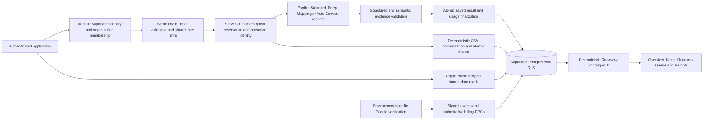

# LostDeal AI — current application architecture

This document describes the genuine SaaS source, not the standalone portfolio showcase. Production remains owner-private Version 49 until an independently approved release. Batch 2 development acceptance, exact commits and test totals belong in the final preservation report; the presence of source code does not prove hosted configuration or a real payment.

## Hosting and trust boundaries

The TypeScript/React App Router application builds with the pinned Vinext/Vite integration into a Cloudflare Worker plus client assets for Sites. Supabase supplies identity and PostgreSQL; D1 supplies shared mutation rate limiting. The Worker has server-only provider and usage-authority configuration. Browser publishable Supabase configuration is intentionally public; privileged Supabase, Paddle and OpenAI credentials must never be browser variables or committed files.

Organization identity is resolved from a verified user and membership on the server. Browser IDs, plan labels and upgrade redirects are not authorization. PostgreSQL RLS and membership/authority-checked RPCs protect business writes; ordinary clients cannot directly write billing, usage or saved analysis authority fields. SECURITY DEFINER entry points require their explicit identity, membership and/or hashed authority checks; their names alone do not prove safety. Historical migrations remain immutable.

## Product data flow

Smart Import accepts canonical or CRM-style CSV, deterministic/manual mapping, explicit text merges and canonical review/download. An optional bounded AI mapping request is a separate, explicit operation. Import commits validated rows, upload provenance and usage atomically. Raw CSV files are not retained by that pipeline.

Auto Convert first tries deterministic handling, then bounded paid schema/extraction work only when explicitly authorized and entitled. Returned rows still enter canonical review and explicit import; there is no automatic tenant import merely from preview. Its partial failure contract preserves unresolved physical row references. A completed operation ID replays stored results; selected-row retry uses a fresh operation ID and charges only successful provider-processed rows.

Standard Analysis extracts structured business-deal interpretation from authorized source content. Deep adds grounded evidence and recovery detail. Output is structurally and semantically checked before persistence; unsupported critical claims fail the operation. AI text is not a promise of customer behavior, a conversion probability or an automatic outbound message.

Recovery Score v1.0 is deterministic: buying intent 50%, reason recoverability 30%, recency 20%. It ranks attention, not the probability of winning. Scoring, saved-page reads, deterministic mapping, normalized downloads and theme changes do not consume AI allowances. Overview/Insights show descriptive counts with denominators; Recovery Queue orders saved opportunities and leaves follow-up to the human.

## Usage and billing

Server-selected OFF/SHADOW/ENFORCED modes are not browser entitlements. Ordinary trial denial in SHADOW is observation, not a hard cost cap. Provider-backed status and failed authority reads have independent fail-closed boundaries. Production remains SHADOW/Paddle Sandbox. Fourteen-day Trial has 50 imports, 10 analyses shared by Standard/Deep, 3 mappings, at most 2 Deep previews within the shared 10, and 25 Auto Convert rows. Starter is USD15/month with 250 imports/30 analyses/3 mappings; Pro is USD45/month with 1,500 imports/250 analyses/30 mappings/1,500 Auto Convert rows. Business remains non-purchasable.

Reservations include active capacity, operation identity and server time. Saved pending analysis usage is finalized idempotently without rerunning a provider. Queue-based PGlite tests are evidence for isolated transaction/operation behavior, not a substitute for independent multi-session PostgreSQL acceptance.

The dormant Live preparation has distinct environment/catalog/receiver/authority boundaries. A checkout callback cannot grant a plan. Exact Live provider metadata, approved origins, database-authority adoption and real lifecycle acceptance remain future gates; see the billing design and [activation runbook](COMMERCIAL_ACTIVATION_RUNBOOK.md). No existing Sandbox tenant is reclassified.

## Reliability, privacy and operations

AuthScreen, onboarding and reset presentation tolerate the framework's successful-redirect undefined-state interval while keeping server-action dispatch, pending/error behavior and password-reset authority. Responsive shell, disclosures and dialogs retain semantic landmarks and focus behavior. Read-only access to historical saved records is separate from mutation eligibility.

Route diagnostics retain bounded category/status/request identity, not source text, provider payloads, cookies or credentials. CSV/AI boundaries and per-deal deletion/export are implemented; whole-tenant privacy requests require an identity-checked operational process, not a claim of automatic global erasure. Backup retention, restore execution, hosted leaked-password protection, delivered alerts and provider currency budgets require actual operational acceptance. No SaaS unit allowance is an OpenAI account spending cap.

## Separate presentation artifact

The standalone showcase uses fictional precomputed records, has no authentication or protected API connectivity, and is explicitly labeled. It complements this application. Its screenshots and interactions do not prove live SaaS, email or Paddle acceptance. Actual application screenshots generated from isolated synthetic fixtures must retain that provenance label.
