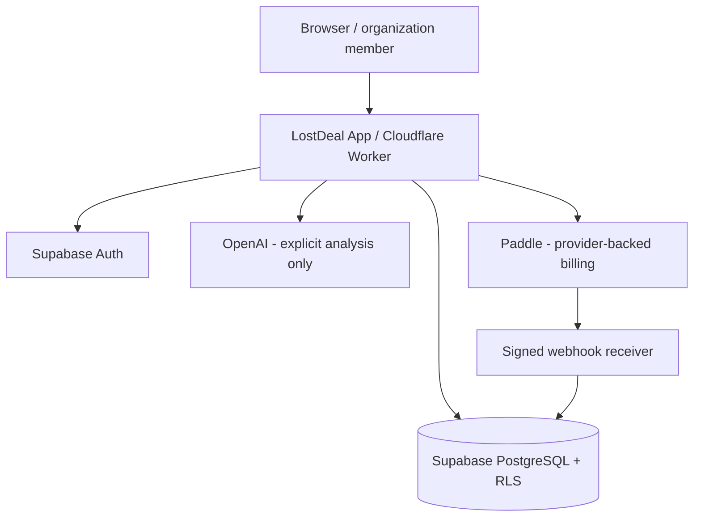

# Architecture overview

LostDeal AI's main workflow is **import → evidence-grounded analysis → deterministic scoring → recovery action**.

## Application layers

| Layer | Responsibility |
| --- | --- |
| Product UI | Overview, Deals, Detail, Recovery Queue, Insights, Imports, Account, Settings and Plan & Billing |
| API and server actions | Authenticated request validation, tenant selection, authorization and controlled mutations |
| CSV / Import | Deterministic canonical mapping, provenance-preserving review and explicit commits |
| AI analysis | Structured evidence-based Standard and Deep interpretations; no background charge on ordinary page load |
| Scoring | Deterministic Recovery Score and priority derived from saved signals, not AI-generated probability claims |
| Persistence | Supabase PostgreSQL with explicit organization-scoped RLS and server-approved authority paths |
| Billing | Paddle Sandbox-tested subscription lifecycle, signed webhook validation and reconciled usage state |

## Trust and safety boundaries

- Client controls never grant subscription entitlements or set usage counters.
- Every protected operation must authorize the caller against their organization.
- Direct table writes do not substitute for server-authoritative billing and usage operations.
- Saved analysis and source evidence remain distinguishable.
- Imports require review; AI Auto Convert does not silently import or run deal analysis.
- Mutations must be idempotent or safely retryable where required.
- API keys and payment secrets stay server-side; no production credentials are committed.

## Important limits

The private technical release does not imply that Live Paddle checkout or public registration is active. Source files in GitHub `current/` still reflect Prompt 16 until the final Version 49 sync is completed. Treat the owner-verified Release 49 checkpoint as source authority.
