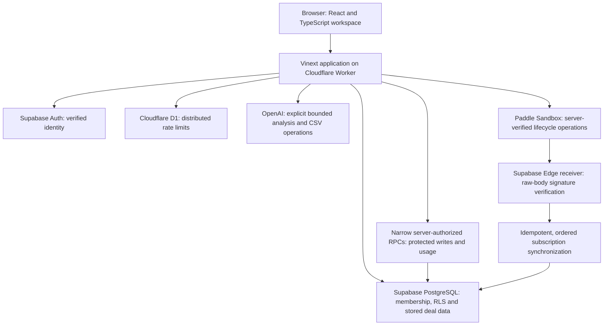

# LostDeal AI — public-safe technical overview

This is the architecture of the genuine SaaS, not the independent static showcase. It deliberately omits private hostnames, project IDs, database object fingerprints, credentials and tenant details. The private preservation packet contains reproducible setup and deeper source contracts.

The browser presents state and requests explicit operations. Authentication, workspace membership, same-origin constraints, bounded input validation and rate limits are checked before protected data or provider work. Database policies enforce tenant separation; narrow authorized functions protect AI-derived state and usage rather than accepting arbitrary client writes.

The CSV pipeline shares parsing, deterministic mappings, normalization, review, duplicate protection and export behavior. Eligible Auto Convert supplies bounded proposals with provenance before the same validator/import boundary. Standard and Deep analysis use strict structured schemas and evidence checks. Recovery Score is ordinary deterministic TypeScript, separate from provider execution.

Usage reservations, operation identities, processing claims and staged result finalization support retries and explicit failure states. These are verified by focused and broader isolated regressions. Test evidence does not by itself prove unlimited multi-session concurrency or production availability.

Paddle Sandbox is the accepted billing foundation. Provider verification, signed webhook ingress and protected subscription synchronization determine authority; a browser callback does not grant a plan. Batch 2's separate Live-preparation work and forward-migration proposal remain subject to their exact isolated test and approval records. This overview does not claim an active Paddle Live deployment, configured Live catalog, seller approval or completed real-payment acceptance.

## Engineering and security achievements

- A typed, responsive application with protected routes, coherent workspace identity, stored intelligence and explicit user actions.
- Tenant-aware data access, RLS and narrow protected write contracts.
- Deterministic CSV validation/scoring separated from optional provider interpretation.
- Evidence-grounded, bounded Standard/Deep output and safe failure presentation.
- Operation/usage durability and duplicate/replay coverage without paid test calls.
- Server-authoritative Sandbox billing, raw-body signature checks and lifecycle regressions.
- Build/artifact verification, source/history scanning, exact historical migration preservation and reproducible checkpoints.

These are engineering controls and recorded validation results, not compliance certifications. Hosted SMTP, leaked-password protection acceptance, provider currency budgets, delivered operational alerts and managed backup/restore evidence are not implied by this diagram. Their activation and real-world tests remain separately documented.
